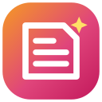
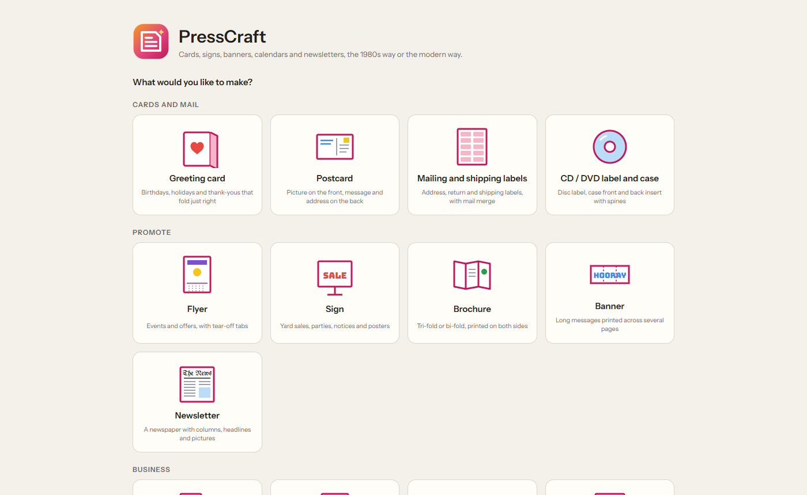
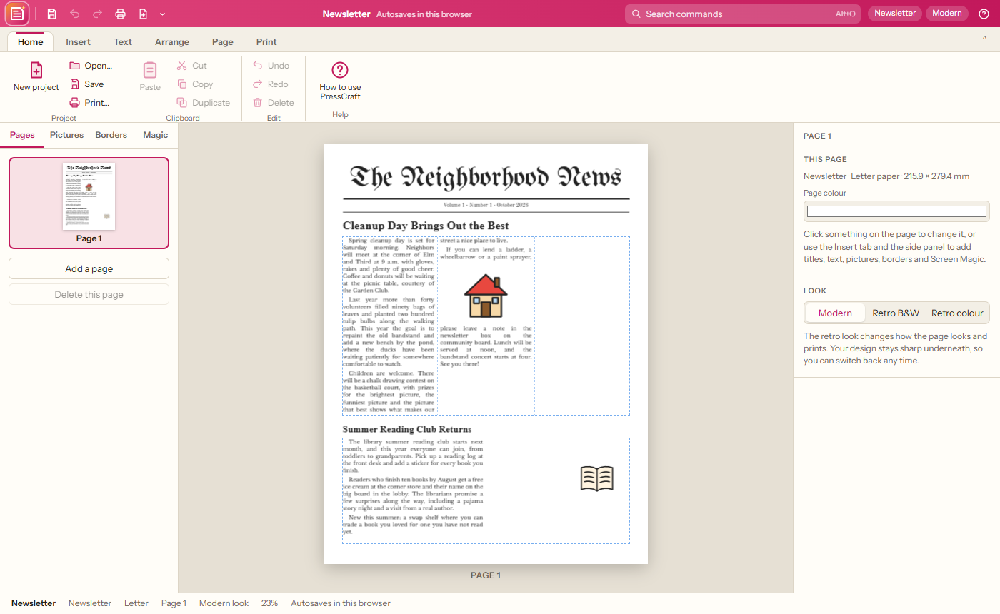
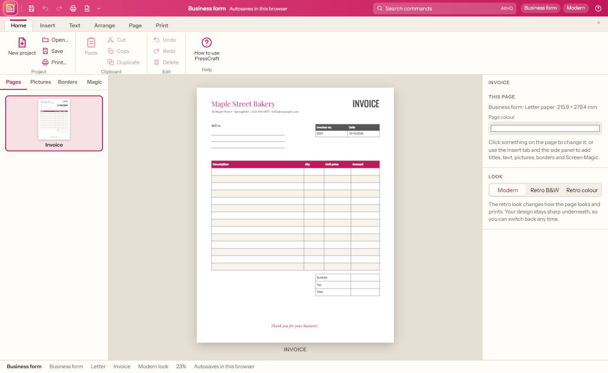
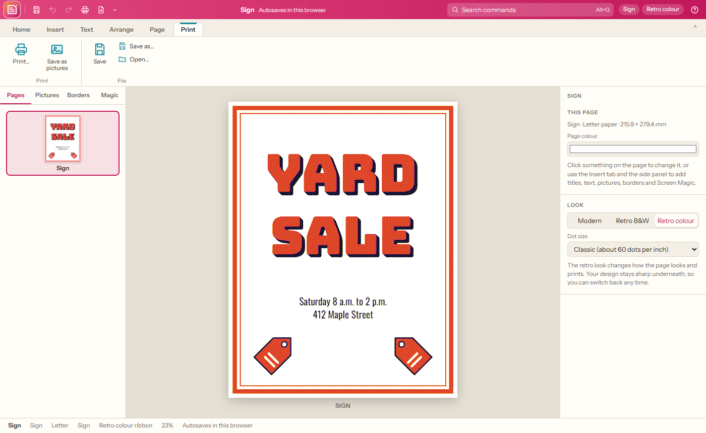
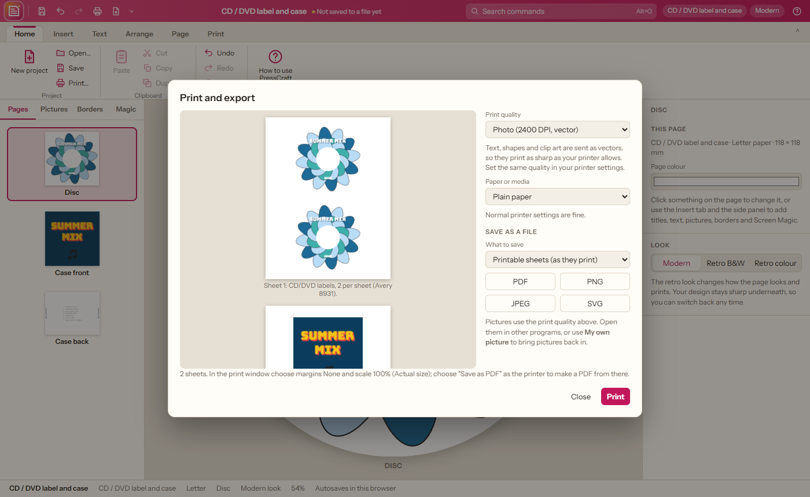
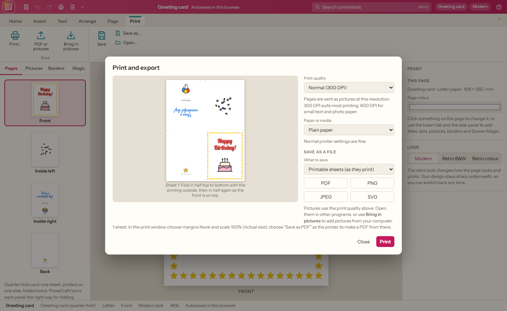

# PressCraft

**Cards, postcards, labels, CD/DVD labels, flyers, signs, brochures, banners, newsletters, stationery, business cards, business forms, certificates and calendars in your browser, the 1980s way or the modern way.**

PressCraft brings back the fun of the classic home-printing programs from the Apple II, Atari and early PC days: pick a project, add a big title, a picture and a border, and print. It also has a newspaper side, with mastheads, headlines and stories that flow in columns around pictures. Flip the **Retro** switch for the chunky dot-matrix look, in black and white or the eight colours of an old colour ribbon. Everything works offline from this folder.

## Getting started

1. Download this repository (green **Code** button › **Download ZIP**) or clone it.
2. Double-click `index.html`. It opens in Chrome or Edge.
3. Choose what to make (and its fold, size, label sheet or form), the paper (Letter or A4), the look (modern, retro, retro colour) and whether to start from an example.
4. Change the words and pictures, then **Print**.

Your project autosaves in the browser; **Save** keeps a `.presscraft.json` file you can open again later.

## Finding your way

| Where | What is there |
| --- | --- |
| **PressCraft logo** (top left) | Every command in classic menus: File, Edit, Insert, Arrange, Page, View, Help (also F10) |
| **Top bar** | Quick buttons (save, undo, redo, print, new project; customize them with ⌄), the project name, **Search commands (Alt+Q)**, project type, look, help |
| **Ribbon tabs** | **Home** (project, clipboard, undo), **Insert** (titles, text, pictures, borders, Screen Magic, shapes, calendar, newspaper story), **Text** (font, size, bold, italic, underline, colour, alignment, title styles), **Arrange** (order, centring, picture layouts), **Page** (modern or retro look, pages, zoom), **Print** |
| **Left side** | **Pages** (cards have front, inside left, inside right and back), **Pictures**, **Borders**, **Magic** |
| **Right side** | Everything about what you clicked: words, fonts, colours, title style, story text, columns, calendar notes… |

## What it does

### Projects

| Group | Projects |
| --- | --- |
| **Cards and mail** | Greeting cards, postcards, mailing and shipping labels (with mail merge), CD/DVD labels and cases |
| **Promote** | Flyers (with tear-off tabs), signs, brochures (tri-fold or bi-fold), banners, newsletters |
| **Business** | Stationery sets (letterhead, envelope and business cards that match), letterhead, business cards, business forms (invoice, receipts, order form, fax cover, memo), certificates |
| **Plan** | Calendars |

Every project can start from a ready-made example or a blank page.

- **Greeting cards**: **quarter-fold** (one sheet, one side, folded twice, like the classic cards) or **half-fold** (two sides). Design the front, inside left, inside right and back; PressCraft turns each panel the right way so the card reads correctly once folded.
- **Signs** tall or wide, **letterhead**, **calendars** (any month, Sunday or Monday first, notes on the days) and **banners** from 2 to 12 pages long, printed sideways and split across sheets with trim marks.
- **Newsletters** of any number of pages, with a masthead, headlines and stories.
- **Postcards** (4 × 6 in, 5.5 × 4.25 in or A6) with the front and the back (message, address lines and stamp box) lined up for two-sided printing.
- **Mailing and shipping labels** on Avery US and A4 sheets (5160, 5161, 5162, 5163, 5164, 5167, 8126, 4 × 6 in, L7160, L7163, L7165, L7169). Paste a list of addresses and each prints on its own label; start anywhere on a partly used sheet.
- **CD/DVD**: the disc label with its centre hole (2 per sheet), the case front and the case back with both spines and fold marks.
- **Brochures**: tri-fold (flap, back, front outside; three panels inside) or bi-fold, with text that flows across the inside panels.
- **Stationery sets**: letterhead, a #10 or DL envelope and business cards that match. **Business cards** print ten to a sheet, with backs lined up.
- **Business forms**: invoice, two receipts per page, order form, fax cover sheet and memo, built from **tables** you can edit (one row per line, cells separated by `|`).
- **Flyers** with **tear-off tabs**, and **certificates** with a seal and signature lines.

### Titles, text and pictures
- **Titles** in **solid, outline, shadow, 3-D** or outline with shadow, in 25 fonts: retro (Press Start 2P, VT323, Silkscreen), display (Bungee, Monoton, Lobster, Pacifico, Rye, Abril Fatface…), newspaper (UnifrakturMaguntia, Old Standard TT, Libre Baskerville) and common system fonts.
- **62 pictures** (celebrations, holidays, nature, animals, home and school, fun and sport, signs and symbols) in colour, as a black outline (like a colouring page) or in one colour of your choice. All are original PressCraft artwork.
- **Picture layouts**: one big, a row of three, tiled, staggered or in the four corners.
- **18 borders**: lines, rounded, stars, hearts, diamonds, flowers, snowflakes, music notes, checkerboard, scallops, chain, art deco, confetti, piano keys… in any colour, thickness and distance from the edge.
- **Screen Magic**: kaleidoscope, starburst, petals, spiral, rings and string-art patterns. Every **Shake it up** makes a new one; use it as a picture or **fill the page** with it.
- Your own pictures, shapes (box, rounded box, circle, star, line) and plain text.

### Newspapers
- Write each story in the **Copy desk** on the right. The story fills its columns (1 to 6, justified or not, with first-line indents) and **runs on into the next frame**, on the same page or the next one. **▼ more text** shows when a story does not fit yet.
- Pictures with **"text flows around this"** switched on push the words aside.

### The retro look
- **Retro B&W** redraws the page in black and white dots (dithered, like a dot-matrix printout). **Retro colour** uses the eight colours of a colour ribbon. Choose fine, classic, chunky or extra-chunky dots.
- It is a look, not a conversion: your design stays sharp underneath and you can switch back at any time. What you see is what prints.

### Printing and saving

- **Print quality** from 150 up to **4800 DPI**, 300 DPI by default. Draft, Normal and High (150, 300, 600) print as pictures; Very high, Photo and Maximum (1200, 2400, 4800) send text, shapes and clip art as **vectors**, so they come out as sharp as your printer can print.
- **Paper and media**: plain, bright white, card stock, matte and glossy photo paper, label sheets, envelopes, sticker paper, magnet sheets, transparency film and **iron-on transfers** (printed mirrored), each with tips for your printer settings.
- **Save as a file** to use in other programs: one multi-page **PDF**, **PNG** or **JPEG** pictures, or **SVG** vector files (several files come in one .zip). Save the printable sheets, or each page or panel on its own.
- **Bring in pictures** adds several pictures from your computer at once.
- **Print** shows the exact sheets first. Cards are laid out for folding, banners are split into pages with trim marks and page numbers, and everything prints at real size (choose margins None and scale 100%). Choose "Save as PDF" as the printer to make a PDF.
- **Save as pictures** writes each sheet as a 300 DPI PNG.

## Keyboard shortcuts

| Action | Keys |
| --- | --- |
| New project / Open / Save / Print | Ctrl+N / Ctrl+O / Ctrl+S / Ctrl+P |
| Undo / Redo | Ctrl+Z / Ctrl+Y |
| Cut / Copy / Paste / Duplicate | Ctrl+X / C / V / D |
| Select all / Delete | Ctrl+A / Delete |
| Nudge 1 mm / 5 mm | Arrows / Shift+Arrows |
| Next / previous page | Page Down / Page Up |
| Zoom in / out / fit | + / − / 0 |
| Search commands / all menus | Alt+Q / F10 |

## Requirements

A current Chrome, Edge or Firefox. No installation and no internet connection needed.

## How this was made

This app is **vibe coded**: its author designed and directed it in plain conversation, feature by feature, and an AI coding assistant (Claude, by Anthropic) wrote the code.

It is a **genuine clean-room build**, not a decompiled or AI-rebuilt copy of anything:
- Nothing was decompiled, disassembled or reverse-engineered, in whole or in part.
- No code, artwork, fonts, icons or data files from any original program were used, and none were given to the AI to work from.
- PressCraft is inspired by the classic 1980s home-printing and newspaper programs; only publicly known features and general ideas guided the design. Every line of code and every picture here was made new.

Open-source libraries it uses are listed with their licences in Credits.

## Credits

- [Fabric.js](https://fabricjs.com) 5.3 (MIT) for the drawing canvas.
- Fonts from Google Fonts under the SIL Open Font License, stored in `fonts/`.
- Inspired by the much-loved home-printing and newspaper programs of the 1980s. PressCraft contains none of their artwork, fonts or code: every picture, border and pattern here is original.

## Development notes

How PressCraft is built is described in [NOTES.md](NOTES.md).
